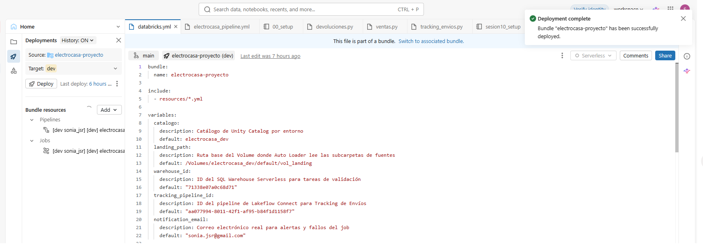
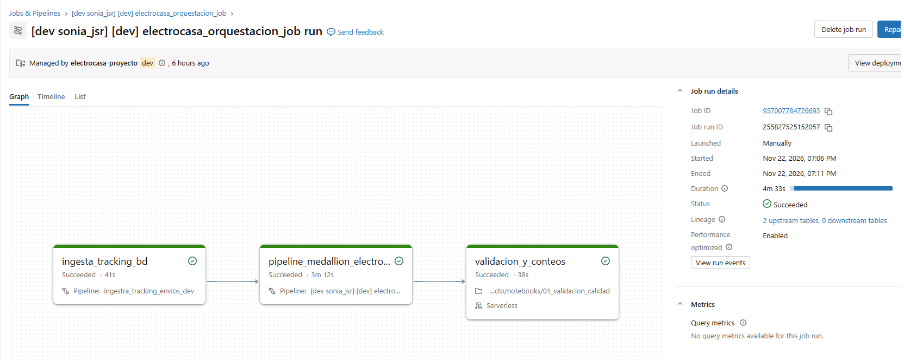
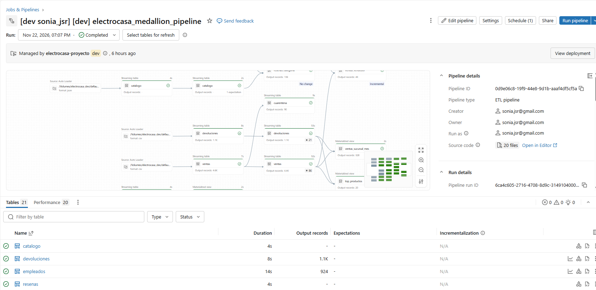
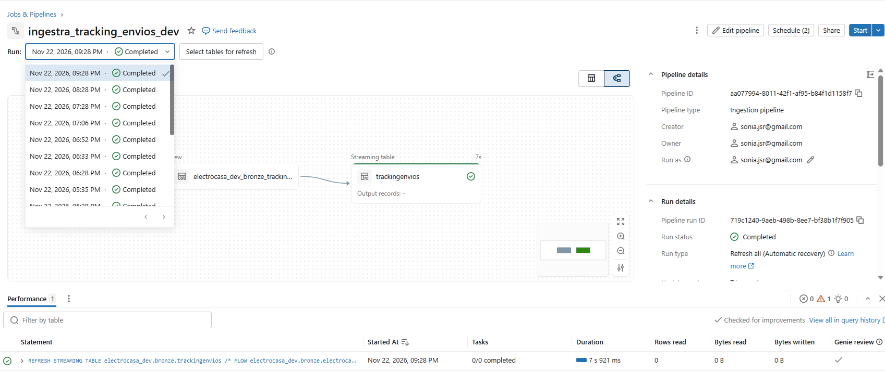
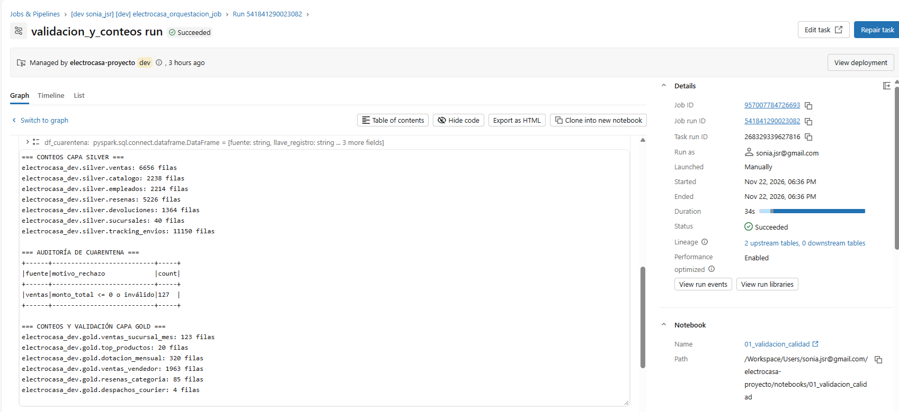
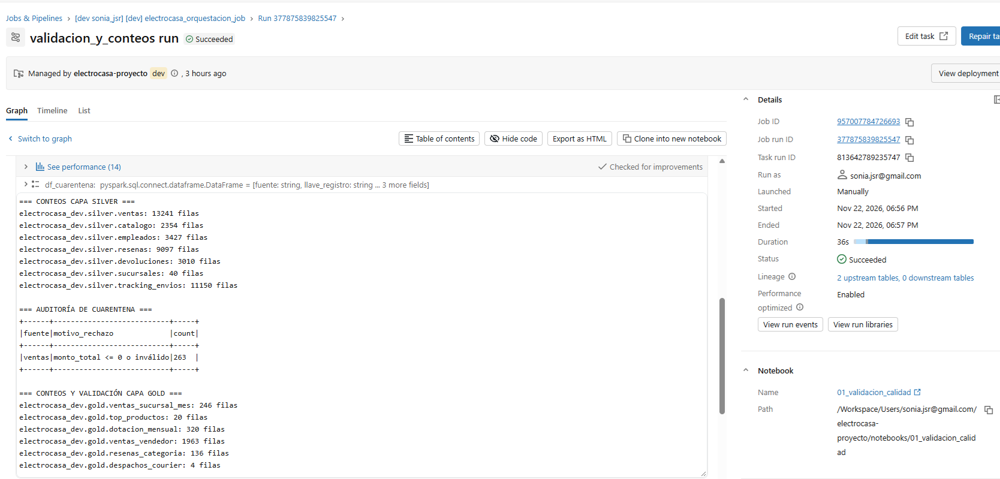
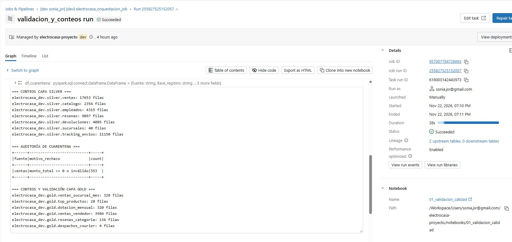

# ElectroCasa Lakehouse — Pipeline Medallion en Databricks

Implementación de una arquitectura **Lakehouse Medallion (Bronze, Silver y Gold)** sobre **Databricks** y **Unity Catalog** (`electrocasa_dev`), desarrollada mediante **Lakeflow Spark Declarative Pipelines**, **Lakeflow Connect** y **Databricks Asset Bundles (DABs)** para consolidar las operaciones comerciales, de recursos humanos, catálogo, atención postventa y logística de ElectroCasa (marzo – octubre 2026).

---

## 1. Caso de Negocio y Arquitectura

**ElectroCasa** es una cadena retail de electrodomésticos que requiere integrar siete fuentes heterogéneas (archivos CSV/JSON por lotes en Unity Catalog Volumes y una base de datos transaccional en Azure SQL) para responder seis preguntas clave de negocio sobre ventas netas, productos más vendidos y devueltos, dotación mensual histórica, desempeño por vendedor, satisfacción de clientes y tiempos de despacho por courier.

### Flujo de Datos (Medallion)

```text
[Azure SQL: dbo.TrackingEnvios] ──(Lakeflow Connect)──┐
                                                      ▼
[UC Volume: vol_landing (CSV/JSON)] ──(Auto Loader)──► [BRONZE] (7 Streaming Tables)
                                                          │
                                                          ▼
                                                       [SILVER] (Limpieza, Deduplicación, SCD2, Column Masking)
                                                          ├──► silver.cuarentena (Registros rechazados)
                                                          ▼
                                                        [GOLD] (6 Materialized Views analíticas)
```

### Decisiones Técnicas Justificadas

| Componente | Decisión Técnica | Justificación |
| :--- | :--- | :--- |
| **Gobernanza y Almacenamiento** | Unity Catalog (`electrocasa_dev`) + Managed Volumes (`vol_landing`) | Centraliza permisos RBAC, linaje automático entre Bronze/Silver/Gold y elimina rutas heredadas de DBFS. |
| **Ingesta de Archivos** | Auto Loader (`readStream.format("cloudFiles")`) con esquemas explícitos en `STRING` | Garantiza procesamiento incremental idempotente lote por lote sin reprocesar archivos previos y evita fallos por desplazamientos posicionales o formatos mixtos. |
| **Ingesta desde Azure SQL** | Lakeflow Connect (`ingestra_tracking_envios_dev`) | Conector nativo gestionado que sincroniza incrementalmente `dbo.TrackingEnvios` hacia `bronze.tracking_envios` por cursor (`fecha_modificacion`). |
| **Historial de Empleados** | `AUTO CDC` almacenado como **SCD Type 2** ordenado por `(fecha_evento_dt, secuencia_evento)` | Permite reconstruir con exactitud la sucursal vigente de cada vendedor en cada fecha de venta y la dotación activa al cierre de cada mes, incluso ante eventos tardíos. |
| **Calidad de Datos y Cuarentena** | Expectativas declarativas (`@dp.expect_or_drop`) + Tabla `silver.cuarentena` | Aísla registros corruptos (montos nulos, negativos o cero) para evitar que contaminen las métricas de Gold, conservando trazabilidad para auditoría. |
| **Seguridad de Datos Sensibles** | Enmascaramiento dinámico (`MASK mask_dato_sensible`) | Protege columnas PII (`dni` y `salario`) en `silver.empleados` según el grupo de usuario en Unity Catalog. |
| **Despliegue y Orquestación** | Databricks Asset Bundles (`databricks.yml` + `resources/*.yml`) | Versiona en Git la infraestructura como código (Pipeline Medallion + Job secuencial de 3 tareas) y habilita promoción entre entornos (`dev` y `prod`). |

---

## 2. Estructura del Repositorio

```text
electrocasa-proyecto/
├── databricks.yml                          # Configuración principal del Asset Bundle (targets dev y prod)
├── pyproject.toml                          # Empaquetado del módulo Python electrocasa
├── contratos/                              # Contratos de datos YAML por entidad (7 archivos)
│   ├── catalogo.yml
│   ├── devoluciones.yml
│   ├── empleados.yml
│   ├── resenas.yml
│   ├── sucursales.yml
│   ├── tracking_envios.yml
│   └── ventas.yml
├── docs/                              # Capturas de despliegue, ejecución y conteos por lote
├── notebooks/
│   ├── 00_setup.ipynb                      # Creación de catálogo, esquemas, volumen, RBAC y masking
│   └── 01_validacion_calidad.ipynb         # Auditoría de conteos por capa, cuarentena y vistas Gold
├── resources/
│   ├── electrocasa_pipeline.yml            # Definición del Lakeflow Declarative Pipeline
│   └── electrocasa_job.yml                 # Job orquestador (Ingesta SQL -> Pipeline -> Validación)
├── src/electrocasa/
│   ├── schemas/bronze/                     # Esquemas StructType explícitos alineados a los CSV/JSON
│   ├── utils/utils.py                      # Funciones reutilizables (limpiar_decimal, parsear_fecha_flexible)
│   └── transformations/
│       ├── bronze/                         # Tablas Streaming de ingesta desde vol_landing
│       ├── silver/                         # Limpieza, deduplicación, SCD2 y silver.cuarentena
│       └── gold/                           # 6 vistas materializadas de negocio

```

---

## 3. Pasos de Despliegue y Ejecución

1. **Inicialización del Entorno (`00_setup.ipynb`):**
   Creación del catálogo `electrocasa_dev`, esquemas (`bronze`, `silver`, `gold`), volumen `vol_landing`, permisos de grupos (`electrocasa_ingenieria`, `electrocasa_analistas`, `electrocasa_auditoria`) y función de enmascaramiento `silver.mask_dato_sensible`.
2. **Validación del Conector de Tracking (Lakeflow Connect):**
   Ejecución inicial del pipeline `ingestra_tracking_envios_dev` desde Azure SQL (`dbo.TrackingEnvios` $\rightarrow$ `bronze.tracking_envios`, cargando `11,150` registros) y segunda corrida incremental verificando `0` filas duplicadas.
3. **Validación y Despliegue del Bundle (DABs):**
   ```bash
   databricks bundle validate -t dev
   databricks bundle deploy -t dev
   ```
4. **Ejecución Incremental por Lotes (`Lote 1` $\rightarrow$ `Lote 2` $\rightarrow$ `Lote 3`):**
   Tras subir cada lote de archivos en `/Volumes/electrocasa_dev/default/vol_landing/`, se ejecutó `[dev] electrocasa_orquestacion_job`, encadenando de punta a punta:
   1. `ingesta_tracking_bd` (actualización incremental desde Azure SQL).
   2. `pipeline_medallion_electrocasa` (procesamiento Bronze $\rightarrow$ Silver $\rightarrow$ Gold).
   3. `validacion_y_conteos` (ejecución automática de `01_validacion_calidad.ipynb`).

---

## 4. Resultados y Conteos Acumulados por Lote

A continuación se presentan los conteos exactos verificados en `01_validacion_calidad.ipynb` tras cada ejecución secuencial del Job:

| Capa / Tabla | Lote 1 (`Run 541841290023082`) | Lote 2 (`Run 377875839825547`) | Lote 3 (`Run 255827525152057`) |
| :--- | :---: | :---: | :---: |
| **Silver — `ventas`** | 6,656 | 13,241 | 17,653 |
| **Silver — `catalogo`** | 2,238 | 2,354 | 2,354 |
| **Silver — `empleados` (SCD2)** | 2,214 | 3,427 | 4,315 |
| **Silver — `resenas`** | 5,226 | 9,097 | 9,097 |
| **Silver — `devoluciones`** | 1,364 | 3,010 | 4,085 |
| **Silver — `sucursales`** | 40 | 40 | 40 |
| **Silver — `tracking_envios`** | 11,150 | 11,150 | 11,150 |
| **Cuarentena — `ventas` (`monto_total <= 0 o inválido`)** | **127** | **263** | **353** |
| **Gold — `ventas_sucursal_mes`** | 123 | 246 | 328 |
| **Gold — `top_productos`** | 20 | 20 | 20 |
| **Gold — `dotacion_mensual`** | 320 | 320 | 320 |
| **Gold — `ventas_vendedor`** | 1,963 | 1,963 | 3,984 |
| **Gold — `resenas_categoria`** | 85 | 136 | 136 |
| **Gold — `despachos_courier`** | 4 | 4 | 4 |

### Observaciones de Calidad e Incrementalidad
* **Trazabilidad en Cuarentena:** Los registros con montos nulos, negativos o cero (`127` en Lote 1, `263` acumulados en Lote 2 y `353` acumulados en Lote 3) fueron desviados automáticamente hacia `silver.cuarentena` sin interrumpir el procesamiento de los registros válidos.
* **Idempotencia:** Las entidades sin archivos nuevos en el Lote 3 (`catalogo`, `resenas`, `sucursales`, `tracking_envios`) mantuvieron exactamente su conteo previo (`2,354`, `9,097`, `40` y `11,150` respectivamente).
* **Consistencia de Negocio en Gold:** `gold.top_productos` mantiene exactamente `20` filas (Top 10 productos más vendidos + Top 10 con mayor tasa de devolución), `gold.dotacion_mensual` cubre los 8 meses para las 40 sucursales (`320` registros) y `gold.despachos_courier` consolida los `4` operadores logísticos.

---

## 5. Retos Técnicos Implementados

1. **Cuarentena con Trazabilidad Completa (`silver.cuarentena`):** Cada registro rechazado durante la limpieza de ventas conserva la entidad fuente (`fuente`), la llave de negocio (`llave_registro`), la regla incumplida (`motivo_rechazo`), el archivo de origen (`archivo_origen`) y la marca temporal de procesamiento (`fecha_procesamiento`), permitiendo su auditoría y reprocesamiento controlado.
2. **Soporte Semi-estructurado (`VARIANT`) en Reseñas:** La columna `metadata` de `bronze.resenas` se ingiere como tipo `VARIANT` en Silver, permitiendo extraer dinámicamente el canal de origen y versión de aplicación sin romper el esquema ante cambios en el JSON.

---

## 6. Evidencias de Ejecución

### 6.1. Despliegue del Bundle, Orquestación y Conector
* **Bundle desplegado (`target: dev`):**
  
* **Job de orquestación (`electrocasa_orquestacion_job`):**
  
* **Pipeline Medallion ejecutado de punta a punta:**
  
* **Ingesta incremental de Tracking (`ingestra_tracking_envios_dev` — 2 corridas):**
  

### 6.2. Conteos y Auditoría por Lote (`validacion_y_conteos`)
* **Ejecución Lote 1 (`Run 541841290023082`):**
  
* **Ejecución Lote 2 (`Run 377875839825547`):**
  
* **Ejecución Lote 3 (`Run 255827525152057`):**
  